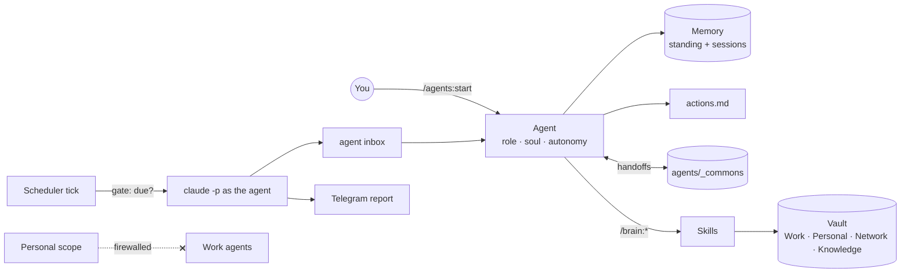

# Agentic Second Brain

Most AI assistants wait for you to tell them what to do. Mine don't: they open every session with a view on my priorities, remember what we decided last week, and tell me when the conversation drifts.

This is the setup I run my work and my life on, every day, in [Claude Code](https://docs.anthropic.com/en/docs/claude-code). Same system, with my data taken out.

Built by Dario Bianchi. New to the idea of a second brain run by Claude? Start with my [Second Brain Guide](https://second-brain-guide.vercel.app).

## What's inside

| # | Part | What it does |
|---|---|---|
| 1 | **`agents` plugin** (`plugins/agents`) | Named agents that drive the agenda. Each one opens the session with priorities, keeps an action tracker, remembers across sessions, and acts within the autonomy levels you set (L1 tell me → L4 act). Scopes keep work and personal apart: personal is firewalled from work agents. Agents hand work to each other through a shared handoffs file. |
| 2 | **`brain` plugin** (`plugins/brain`) | 16 skills, invoked as `/brain:<skill>`: meeting transcripts and batch sync, writing in your own voice, data analysis, market research, decks, product feedback, CV tailoring, job sweeps, tech news, and more. |
| 3 | **Scheduler** (inside the `agents` plugin template) | Runs agents on a schedule, without you. **macOS (launchd) is what I run and test daily; Linux (systemd or cron) and Windows (WSL + Task Scheduler) installers ship too, tested by dry run only so far.** A cheap gate decides what is due before any model call, so idle ticks cost nothing. Every run writes a record and can message you on Telegram. A daily health check flags anything that missed, failed or went stale. |
| 4 | **Starter vault** (`vault-template/`) | Folder structure, a `CLAUDE.md` with the operating rules, agent conventions, and one example agent (Atlas, a chief of staff) to copy and adapt. |

## Install

Inside Claude Code:

```
/plugin marketplace add dariobianchi00/agentic-second-brain
/plugin install agents@agentic-second-brain
/plugin install brain@agentic-second-brain
```

Then restart Claude Code. Plugins load only on a full restart.

## Quick start

1. Copy `vault-template/` to where your notes will live, and open Claude Code there.
2. Fill in `CLAUDE.md` (who you are, your priorities) and your first name as `principal:` in `agents/CONVENTIONS.md`.
3. Run `/agents:init`. It adds what the template leaves to the plugin: the shared tools index, the scheduler folder and its task register. It never overwrites a file.
4. Run `/agents:start atlas`. Atlas reads its files, declares the priorities and asks what to work on.
5. Create your own agents with `/agents:new`.
6. To run agents unattended, set up the scheduler from `agents/scheduler/README.md`.

## Requirements

1. Claude Code.
2. Python 3 (scheduler, hooks).
3. Agents and skills work on any OS that runs Claude Code. The scheduler: macOS (tested daily), Linux and Windows via WSL (dry-run tested; reports welcome).
4. Optional: Herdr to run several agents side by side (peer requests, the "needs you" marker in the sidebar); Telegram for run reports; email, calendar and Google Drive MCP servers for the skills that read them.

## How it fits together



## A day with it

1. **Overnight**, the scheduler runs what is due: inbox triage, a weekly meeting sync, any handoff another agent left open. Each run writes to that agent's inbox and sends me one line on Telegram.
2. **Morning**, I start my chief of staff. It reads its tracker, the open handoffs and what came in overnight, then proposes the day's three priorities and the one thing it disagrees with. Real first-session output: [`docs/demo/atlas-first-session.md`](docs/demo/atlas-first-session.md).
3. **During the day**, meetings go through `/brain:transcript`: notes, decisions and action items land in the right files; anything ambiguous is proposed one by one. Real output: [`docs/demo/transcript-pricing-meeting.md`](docs/demo/transcript-pricing-meeting.md).
4. **When an agent needs me**, its last line says `⏳ NEEDS <me>: …`, and the Herdr sidebar lights up for that pane.
5. **Evening**, each agent closes its session: memory written, tracker updated, one line in the changelog.

## How I use it

The agents are not task runners. Each one owns a lane, sets the agenda at the start of the session, challenges my framing, and calls out drift. I steer.

Design notes for the agent framework: [`plugins/agents/PHILOSOPHY.md`](plugins/agents/PHILOSOPHY.md).

## Credits

The `agents` plugin is a branch of [Norman Noble's agent-framework](https://github.com/normannoble/agent-framework) (MIT). The autonomy model, the session mechanics and the memory design are his. The scope firewall, commons, scheduler toolkit and hooks are what I added. See [`plugins/agents/CHANGELOG.md`](plugins/agents/CHANGELOG.md).

The 16 skills in the `brain` plugin are mine. Where a skill builds on someone else's published method, the skill names the source.

## License

MIT. See [LICENSE](LICENSE).
